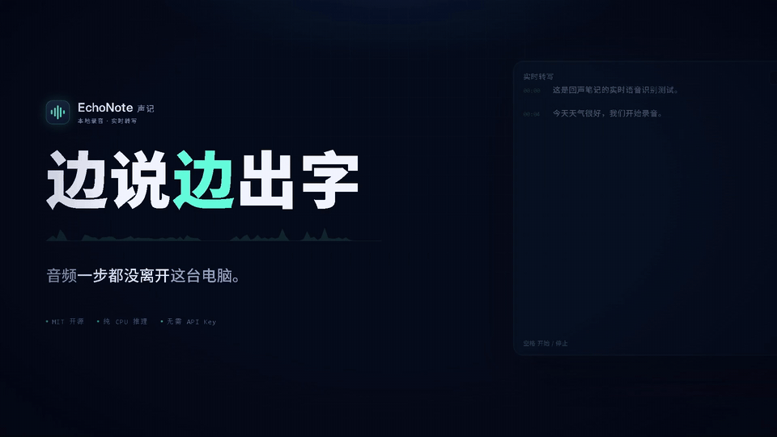
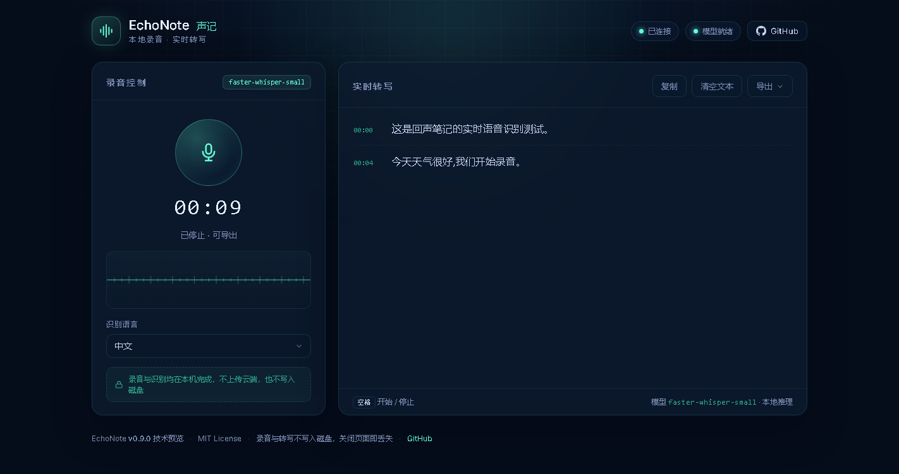
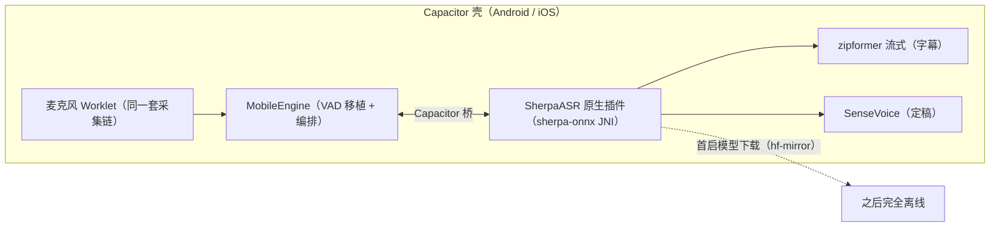

<div align="center">

# 🎙 EchoNote · 声记

**本地运行的开源录音 + 实时语音转文字工具**

[](https://www.python.org)
[](https://fastapi.tiangolo.com)
[](#-引擎与基准)
[](LICENSE)
[](#-快速开始)
[](mobile/README.md)

边说边出字 · 录音不上传 · 装好模型后完全离线 · 支持中英日韩等多语言

</div>

---

> **v1.0.0**：桌面版（Windows 便携包 / 源码）与 **Android App**（Capacitor + 原生
> sherpa-onnx，离线识别）双端形态，iOS 工程已就绪。老规矩三件事：**实验性**；
> **延迟取决于硬件**（本机实测首字 2.8 s、停顿后 1 s 出定稿，见下文口径）；
> **首次准备要下载模型**（桌面双档 / 手机约 270 MB），之后可完全断网运行。

🎬 **30 秒宣传片**（边说边出字 · 四种导出 · 隐私承诺）：



▶️ [观看高清版视频（MP4，点开即播）](docs/promo/echonote-promo.mp4) · [Releases 页下载](https://github.com/Qsianuo/echonote/releases/latest)

---

## ✨ 功能

- 🎙 **一键录音 · 暂停/继续** —— 一段录音随时暂停接着录，时间轴自动对齐，导出 TXT/SRT/WAV/MD
- 🧠 **SenseVoice 定稿引擎（v1.0.0 新增）** —— FunASR 系离线模型，自带标点与数字规整，比 Whisper 定稿快约 5 倍
- 🎭 **录入情境** —— 个人模式（近讲低延迟）/ 会议模式（抬高信噪门限 + 更严切句，挡键盘咳嗽这类短促杂音）
- 📱 **Android App** —— 同一套前端 + 原生 sherpa-onnx 插件，录音/转写/回放/导出全在手机本地
- 🌐 **手机免装访问** —— 电脑开一个局域网服务，iPhone/安卓浏览器扫码即用（PWA）
- 🔇 **采集降噪** —— 80 Hz 高通 + 50/100/150 Hz 工频陷波 + 两级抗混叠低通 + 自适应增益（+24 dB 上限）
- ⚡ **边说边出字** —— 流式模型画实时字幕，更准的模型在每句结束后重写定稿（本机样本字符错误率 0）
- 🔌 **真正离线** —— 模型在磁盘上时识别全程零联网；`--offline` 还能强制断网启动
- 🌍 **多语言** —— 中文 / 英文 / 日文 / 韩文 / 法文 / 德文 / 西班牙文 / 俄文，可自动识别
- 💾 **边录边落盘** —— 音频分片写入浏览器 OPFS，录音期间内存占用与时长无关，隐私模式自动降级
- ▶️ **回放与字幕联动** —— 点任意字幕跳转播放并高亮，播放条激活时空格控制播放
- ⏱ **逐段延迟埋点** —— 每句的「首字 / 定稿 / 精修」毫秒数逐段上报（见「延迟口径」）
- 🎨 **深色界面** · ⌨️ **全键盘可用** · ♿ **读屏友好**



> 截图取自 v0.10.0 打包版实际运行（离线模式 + 8.95 s 中文样例音频）。v0.11 的界面在模型标签上显示「实时 极速 · 定稿 快速」，
> 并为定稿过程加了「精修中 / 已精修」标记。全套流程见
> `docs/screenshots/`：空态 → 录音中 → 停止后字幕 → 导出菜单 → 窄屏。
> 该次录音导出的四种文件在 `docs/examples/`。

---

## 🏗 架构

**桌面版**：Python 服务承载切句与识别，浏览器只负责采集与展示。

```mermaid
flowchart LR
    subgraph B["浏览器"]
        MIC[麦克风] --> W["采集 Worklet（高通·陷波·AGC·重采样）"]
        W -->|16kHz PCM 帧| UI[界面 / 波形 / 导出]
    end
    W -->|WebSocket| subgraph S["Python 服务（127.0.0.1:8000）"]
        VAD["VAD 切句（自适应门限 / 情境预设）"] --> LIVE["实时字幕（zipformer 流式）"]
        VAD --> FIN["定稿 + 精修（SenseVoice / Whisper / 远程）"]
    end
    LIVE -->|partial| UI
    FIN -->|final / refine| UI
```

**移动版**：同一套前端，识别下沉到原生层——无服务器、模型下载后完全离线。



VAD 与编排层的跨端移植由**双语言一致性测试**守护：同一份音频，Python 版与 JS 版必须切出相同的段落（`mobile/test/`，6 组样本含会议门限用例）。

---

## 🧠 引擎与基准

本机实测（8.95 s 中文样音，个人模式，`tools/bench_cer.py` 可复现）：

| 引擎 | 角色 | 耗时 | RTF | CER | 标点 |
|---|---|---|---|---|---|
| **SenseVoice int8** | 定稿/精修 | 2.0 s | 0.23 | 0.0% | ✅ 自动 |
| zipformer 流式 | 实时字幕 | 6.1 s | 0.68 | 0.0% | ❌ |
| whisper medium | 定稿（桌面可选） | 11.5 s | 1.28 | 0.0% | ✅ |

SenseVoice 是 FunASR 系离线模型（zh/en/ja/ko/yue）：非自回归一次出整句，比逐 token 的 Whisper 快一个身位，且自带标点——这也是它成为 v1.0.0 默认定稿引擎之一的原因。切换入口：`ECHONOTE_ASR_BACKEND=sensevoice`。

---

## 📱 移动端

- **Android App**：Capacitor 壳 + 原生 sherpa-onnx 插件（JNI），录音/转写/回放/导出全在手机本地，首启下载约 270 MB 模型后飞行模式可用。构建步骤与签名说明见 [mobile/README.md](mobile/README.md)。
- **iPhone 免装体验**：`启动手机访问.bat` → Safari 扫码 → 信任证书 → 录音（与 Android 同源的前端），详见 [docs/手机访问指南.md](docs/手机访问指南.md)。
- **原生 iOS 包**：Xcode 工程与 Swift 插件源码已就绪（`mobile/ios/`、`mobile/ios-plugin/`），构建需 Mac + Apple 开发者账号。

---

## 📥 下载即用（Windows，不用装 Python）

去 [Releases](https://github.com/Qsianuo/echonote/releases) 下载最新的
`EchoNote-*-windows-x64.zip`，解压后双击 `EchoNote.exe` 即可。

1. 解压到**任意可写目录**（例如 `D:\EchoNote`），不要放 `C:\Program Files`
2. 双击 **`fetch-model.bat`** 准备模型（实时字幕 145 MB + 定稿 1.5 GB，自动走国内镜像）
3. 双击 `EchoNote.exe`，会打开一个**独立的应用窗口**（没有地址栏和标签页），点麦克风开始录音
4. 关闭应用窗口即退出；后台进程会在几秒后自行结束

> 已有离线模型包的，把 `models\` 整个目录放进解压目录（与 `EchoNote.exe` 同级）即可跳过第 2 步。

排查问题用自检命令，会把原生依赖、前端资源、模型状态逐项列出来：

```bat
EchoNote.exe --self-test
```

> 绿色版，不写注册表、不留后台服务。录音与识别全在本机，音频不会离开电脑。

---

## 🔌 离线使用

模型一旦落在 `models\` 里，**识别过程不会再发任何网络请求** —— 不是"缓存可能命中"，而是加载时直接拿本地目录，faster-whisper 根本没有机会去查 Hub。

三种离线场景：

| 场景 | 做法 |
|---|---|
| 先联网准备一次，之后断网 | 跑一次 `fetch-model.bat`，或 `python tools/fetch_model.py` |
| 完全隔离的机器 | 在有网的机器上下载 `models\` 目录，拷到目标机器 exe 同级 |
| 需要硬保证不联网 | `EchoNote.exe --offline`（或 `ECHONOTE_OFFLINE=1`），缺模型时立刻报错并给出应放路径，不会卡在下载上 |

验证离线是否真的生效：

```bat
EchoNote.exe --self-test
```

输出里 `model on disk : yes` 表示权重已在本机；界面上出现绿色的 **「离线可用」** 角标，表示当前进程加载的就是本地权重。

界面里的 `识别模型` 下拉框可以随时切换已安装的档位，切换只加载本地文件，**不会触发下载**。

---

## 🚀 从源码运行

### Windows（推荐）

1. 安装 [Python 3.10+](https://www.python.org/downloads/)（安装时勾选 **Add Python to PATH**）
2. 双击 **`start.bat`**
3. 脚本会先等模型就绪，再自动打开 `http://127.0.0.1:8000`
4. 顶部显示「模型就绪」后，点击麦克风开始录音

启动脚本只在 `requirements.txt` 变化时安装依赖，因此**离线二次启动不会被 pip 阻塞**。

### macOS / Linux

```bash
chmod +x run.sh
./run.sh
```

### 手动启动

```bash
python -m venv .venv
source .venv/bin/activate        # Windows: .venv\Scripts\activate
pip install -r requirements.txt
python -m app
```

> 用 `python -m app` 而不是直接 `uvicorn`，可以保留「非本机地址默认拒绝启动」的保护。

### 自己打包

```bash
pip install pyinstaller
pyinstaller packaging/echonote.spec --noconfirm
python packaging/smoke_test.py dist/EchoNote/EchoNote.exe
```

产物在 `dist/EchoNote/`，整个目录压缩后即可分发。推送 `v*` 标签会由
`.github/workflows/release.yml` 自动构建并附加到 Release。

---

## ⚡ 延迟口径（重要）

**① 每次调用的成本几乎是常数。** Whisper 会把音频补齐到 30 s 再编码，所以一次 `transcribe()` 的耗时与音频长短关系很小。开发机（i5-8300H，4 核 8 线程，纯 CPU int8）上 `base` 每次调用 1.0–1.4 s，`small` 约 1.1 s（9 s 音频）/ 1.2 s（1.5 s 音频）。

**② 所以「切碎了喂」是最差的做法。** v0.10 用 `large-v3-turbo` 把录音切成 3 s 一句、每句调一次，固定开销叠了十几倍，实测 RTF 3.9 —— 说一句要等十几秒。

v0.11 换掉的就是这个结构：**VAD 只负责判断「有人在说话」，音频连续流入一个增长中的缓冲**，实时字幕按增量解码，句子结束再定稿。

| 环节 | 用什么模型 | 本机实测 |
|---|---|---|
| 首条字幕出现 | `base`（极速，145 MB） | **2.8–3.4 s**（首帧起算，含 VAD 起步 2 s 缓冲） |
| 说话过程中刷新 | `base` | 每 ~0.7–1.4 s 一次，逐字追加 |
| 停顿后定稿 | `base`（复用实时结果） | **0.0–1.1 s** |
| 定稿精修 | `medium`（均衡，1.5 GB） | **~12 s**（后台，不挡字幕） |

**三个延迟数、两个原点，不能混着读。** `timing` 消息里的毫秒数（口径见 `app/timing.py`）分两类原点：

| 字段 | 原点 | 为什么是这个原点 |
|---|---|---|
| `to_first_text_ms` | **语音起点**（开口那一刻） | 实时字幕在用户还在说话时就出现，从「说完」算会是负数 |
| `to_final_text_ms` | **关句时刻**（VAD 判定说完那一刻） | 用户真正等的是"我停了，多久出定稿" |
| `to_refined_ms` | **关句时刻** | 同上，精修在定稿之后再往后 |

所以：

- **首字延迟不能用「说完」去读。** 表里的 2.8 s 是「从开口到第一个字」，不是「从停顿到第一个字」；拿停顿当原点算首字，得到的是一个物理上不存在的数。
- **「关句时刻」比真实停顿晚约 `VAD_HANGOVER_MS`**（默认 900 ms）。VAD 要连续听到 900 ms 静音才判定这句结束，而人放下话就开始等了 —— 定稿/精修的体感延迟 = `to_final_text_ms` / `to_refined_ms` + 约 900 ms 的 hangover。

**准确性优先。** 同一段 8.95 s 样本，用应用真实的定稿参数（beam 5 + 承接上下文 + 中文 prompt）实测：

| 定稿档 | 耗时 | 字符错误率 | 输出 |
|---|---|---|---|
| `small` | 3.7 s | 3.4% | …回声笔记的**时时**语音识别测试… |
| `medium` | 12.1 s | **0.0%** | 全对 |
| `large-v3-turbo` | 15.7 s | **0.0%** | 全对 |

`medium` 与 `turbo` 在这段样本上并列满分，`medium` 快 23%、小 90 MB，所以默认用它；想要更新的蒸馏模型可在下拉框里切 `turbo`。`small` 只差一个字，但那一个字正是笔记里最要命的同音字。

代价要讲清楚：12 s/句 ≈ 2.4 倍实时，**长篇连续说话时精修会排队**。队列现在按音频秒数计（默认 240 s），超过才丢弃并提示；停止录音时会按积压量等精修落地（上限 60 s），不会让你导出半成品。

对比 v0.10 同一段 8.95 s 音频、同一台机器：首条字幕 **8.25 s → 2.8 s**，停顿后定稿 **2.2 s → 1.0 s**。

几个刻意的取舍，都写在代码注释里，这里只列结论：

- **首条字幕要等 2 s 缓冲**，不是 1 s。1.2 s 缓冲时 `base` 会把「你好，这是回声笔记」读成「以后，这是」—— 少等 1 s，用户先看到一句错话。
- **置信度门限是量出来的**（`LIVE_MIN_LOGPROB = -1.2`）。1.2–2.0 s 缓冲的真实读数落在 −1.09 ~ −0.33，最初拍的 −0.85 把正确字幕全丢了。
- **短缓冲会被丢弃**：句尾解码若赶不上句尾，就直接重解一次整句，而不是等一个覆盖不到句尾的在途解码（那会白等 1.6 s）。
- **小模型吃词表，不吃 prompt**：`tiny` 会把指令 prompt 当问题来回答（界面上出现「请使用简体中文和标点符号转写。」）；换成短提示词「以下是普通话录音。」后繁体消失、也不再复读。真正提升准确率的是「专有名词」——同一段样本 CER 27.6% → 13.8%。
- **精修会让路**：只要还在说话、或有定稿在途，精修线程就不启动 —— 两个模型抢 4 个核，会把 0.9 s 的解码拖成 3.9 s。

- 服务端把实测值放进状态：界面显示「实时字幕每次解码约 N 秒」，不用你自己算。
- **逐段延迟可以自己量**：每句话结束后，服务端会发一条 `timing` 消息（见协议段），带上到「首字 / 定稿 / 精修」各花了多少毫秒；注意首字的原点是语音起点，定稿与精修的原点是关句时刻（比真实停顿晚约 900 ms），三个数不能放在同一条基线上比较。上表的数字是本机一次实测，不是保证值——你的硬件、模型档位、句长都会改变它，`timing` 就是给这件事用的口径。
- 「识别模型」下拉框可随时切换，切换只加载本地文件，**不会触发下载**。
- A/B/C 档的 p95 门禁（首条 partial ≤2.0 s、final ≤3.0 s）**仍未达标**：首字 2.8 s 卡在「2 s 缓冲 + 1 次解码」的物理下限，要再快只能换更强的 CPU 或更小的模型。这是技术预览的原因之一。

---

## 🌐 模型下载与国内网络

模型托管在 Hugging Face。`fetch-model.bat` 与 `python tools/fetch_model.py` 默认就走 `https://hf-mirror.com`，并且关掉了镜像无法代理的 Xet 通道：

```bash
# 默认双档：极速 145 MB（实时字幕）+ 快速 464 MB（定稿）
python tools/fetch_model.py

# 指定档位 / 换源 / 强制重下
python tools/fetch_model.py --model small
python tools/fetch_model.py --endpoint https://huggingface.co
python tools/fetch_model.py --force

# 查看有哪些档、哪些已经装好
python tools/fetch_model.py --list
```

也可以手工把任意转换好的模型目录放到 `models/<名字>/`（需含 `model.bin` 与 `config.json`），再用 `ECHONOTE_MODEL=<目录>` 指过去。

---

## ⚙️ 配置

所有配置通过环境变量覆盖，无需改代码：

| 变量 | 默认值 | 说明 |
|------|--------|------|
| `ECHONOTE_MODEL` | `medium` | 定稿档位：`base` / `small` / `medium` / `large-v3-turbo` / `large-v3`，或任意本地目录 |
| `ECHONOTE_MODEL_DIR` | `./models` | 模型目录 |
| `ECHONOTE_OFFLINE` | 未设置 | 设为 `1` 后禁止一切联网；缺模型时立即报错并给出应放路径 |
| `ECHONOTE_LANGUAGE` | `zh` | 默认语言，如 `zh`、`en`；`auto` 为自动识别 |
| `ECHONOTE_ASR_BACKEND` | 自动 | 定稿引擎：`sensevoice`（v1.0.0 新增）/ `sherpa`（流式）/ `whisper` / `remote`（OpenAI 兼容接口） |
| `ECHONOTE_MODE` | `personal` | 录入情境：`personal`（近讲低延迟）/ `meeting`（远场抗噪），界面可切并粘性记忆 |
| `ECHONOTE_VAD_THRESHOLD` | `0.010` | 能量阈值。**数值越大越不灵敏**（更难触发），越小越容易把噪声当语音 |
| `ECHONOTE_VAD_HANGOVER_MS` | `900` | 停顿多久算一句结束。按 30 ms 取整，**实际 900 ms** |
| `ECHONOTE_VAD_MIN_SPEECH_MS` | `240` | 最短语音，按帧取整后**实际 240 ms**，更短的片段直接丢弃 |
| `ECHONOTE_VAD_MAX_SEGMENT_S` | `30` | 单段最长时长，到点强制切分。切太短会丢上下文，反而更不准 |
| `ECHONOTE_VAD_PREROLL_MS` | `300` | **预滚**：确认「有人在说话」之前的那段音频也送进解码，避免句首轻声、清辅音被切掉。按 30 ms 取整（300 → 10 帧）；代价是字幕时间轴最多前移 300 ms |
| `ECHONOTE_BEAM_SIZE` | `5` | final 的 beam 宽度；`1` 更快但错字更多 |
| `ECHONOTE_TEMP_FALLBACK` | 未设置 | 开启温度回退阶梯。**本机实测会把 30 s 音频截断到 1/3，默认关闭** |
| `ECHONOTE_CONDITION_ON_PREVIOUS` | `1` | final 是否承接上一句上下文 |
| `ECHONOTE_PROMPT_ZH` | 见源码 | 中文 initial_prompt，用于压住繁体与无标点输出 |
| `ECHONOTE_CPU_THREADS` | `0` | ctranslate2 线程数，`0` 为自动 |
| `ECHONOTE_LIVE_MODEL` | 自动 | 实时字幕用哪个档；默认取已安装的最快一档（`base` > `small` > `tiny`），都没有就用定稿档 |
| `ECHONOTE_DISABLE_LIVE` | 未设置 | 设为 `1` 退回 v0.10 行为：没有增量字幕，每句结束才出文字 |
| `ECHONOTE_LIVE_STEP_S` | `0.6` | 实时解码的**下限节流**：至少来了这么多新音频才解一次，不是承诺值 |
| `ECHONOTE_DISABLE_REFINE` | 未设置 | 设为 `1` 关闭定稿精修，字幕只保留实时档的结果（更快，但准确率降一档） |
| `ECHONOTE_HOTWORDS` | 读 `models/hotwords.txt` | 专有名词表。优先级：环境变量 > `models/hotwords.txt` > 内置默认值 |
| `ECHONOTE_TIMING_LOG` | 未设置 | 设为 `1` 把每轮的逐段延迟额外打成一行 `[TURN_TIMING]` 日志（`timing` 消息本身始终发送） |
| `ECHONOTE_PEAK_NORMALIZE` | 未设置 | 峰值归一化，实验性，**默认关闭**。开启前请自行用同批样本对比 CER——**本项目未实测其 CER**，且可能把环境噪声一并抬起来，**不建议默认开启** |

### 专有名词表（`models/hotwords.txt`）

识别不准，九成是**同音字选错**：「焦距」听成「脚距」，「光圈」听成「光圈」以外的东西。Whisper 的解码器可以在候选之间偏向你给的词——这就是词表，实测是比调任何解码参数都管用的一招。

文件放在 `models/hotwords.txt`，一行一个词，`#` 开头是注释，改完**下一次解码就生效**，不用重启。界面里的「专有名词」输入框改的是同一个值。

两条限制是量出来的，不是猜的：

1. **约 52 个词封顶。** faster-whisper 会把 hotwords 截断到 224 个 token，而且**静默丢弃**尾部。52 个摄影词 = 171 字符 = 221 token，正好在界内；超了不会报错，只会悄悄失效。
2. **只放你真的会说的词。** 词表是解码提示，小模型会顺着它往下续写。填了音频里不会出现的词，它反而在句子里插字——实测多放一个「语音识别」，句子里稳定多出一个「课」。词表与录音内容不匹配时，`tiny` 还会陷入复读循环（`记记记记…`），已加防复读闸兜底。

仓库里 `models/hotwords.txt` 是一份摄影讲课的词表（相机/镜头/打光/焦距/光圈/曝光那一套），照着这个格式换成你的领域即可。
| `ECHONOTE_REFINE_BACKLOG_S` | `240` | 精修积压的音频秒数上限，超过才丢弃最旧的一条并提示 |
| `ECHONOTE_REFINE_DRAIN_MAX_S` | `60` | 停止录音后等待精修完成的上限 |
| `ECHONOTE_MAX_RECORD_MINUTES` | `90` | 录音时长软上限；`0` 表示不限（界面会提示：音频边录边落盘，内存与时长无关，只与回放窗口和降级模式有关） |
| `ECHONOTE_HOST` | `127.0.0.1` | 监听地址（启动脚本会让它生效） |
| `ECHONOTE_PORT` | `8000` | 端口（启动脚本会让它生效） |
| `ECHONOTE_ALLOW_NONLOCAL` | 未设置 | 允许非回环监听。必须同时设置令牌，否则拒绝启动 |
| `ECHONOTE_ACCESS_TOKEN` | 空 | 非回环部署时的访问令牌，WebSocket 需带 `?token=` |
| `ECHONOTE_ALLOWED_ORIGINS` | 空 | 额外允许的 Origin，逗号分隔 |

### 模型选择建议

| 模型 | 体积 | 整段 RTF（9 s） | 中文表现 | 适合 |
|------|------|----------------|---------|------|
| **`tiny`** | ~75 MB | 0.14 | 本机样本 CER 27.6%，**填词表后 13.8%** | 体积优先；配合「专有名词」才能用 |
| **`base`** | ~145 MB | 0.12 | 本机样本 CER 20.7%，错字较多 | **实时字幕默认档**；单次解码 ~1.1 s |
| `small` | ~464 MB | 0.41 | 本机样本 CER 3.4%（定稿参数下），「实时」听成「时时」 | 4 核且要精修跟得上说话 |
| **`medium`** | ~1.5 GB | 1.08 | 本机样本 CER **0.0%** | **定稿默认档**；单句精修 ~12 s |
| `large-v3-turbo` | ~1.6 GB | 1.50 | 本机样本 CER **0.0%**，与 medium 并列 | 想要更新的蒸馏模型；单句 ~16 s |
| `large-v3` | ~3.1 GB | 未测 | 理论最好 | 8 核以上再考虑 |

> 纯 CPU 即可运行（int8 量化），独立显卡不是必需的。int8 与 float32 在本机样本上输出**逐字相同**，只是慢 40%，所以量化不是准确率的瓶颈，模型规模才是。
>
> 实时字幕用 `base`、定稿用 `medium`，是刻意分工：实时那句只活几秒就被重写，错一个字的代价远小于晚一秒出字；而定稿是你要读、要导出的那一份，所以用最准的。
>
> 这个 CER 是在**一段**人工核对过的音频上算的，用于横向比较三个模型，不代表通用中文准确率。完整基线需要 ≥30 句人工标注录音（见 `docs/consistency-checklist.md`）。

---

## 🧱 使用边界

| 项 | 值 |
|----|----|
| 上行音频 | Int16 PCM / 16 kHz / 单声道，**合并后每帧 ≥100 ms**，服务端约 10 帧/秒 |
| 单帧上限 | 32 KiB，超出即断开并返回 `frame_too_large` |
| 服务端积压 | 最多缓存 60 s 音频，溢出时**丢最旧、保最新**并回 `warning`（不静默） |
| 并发会话 | 单进程最多 2 个，第 3 个收到 `busy` |
| 录音时长 | 默认软上限 90 分钟，72 分钟提示；到上限自动停止但保留全部文字与音频 |
| 落盘 | 录音期间音频分片由浏览器同步写入自己的站点存储（OPFS），停止时把 `.pcm.tmp` 改名为 `.pcm`；服务端**不写磁盘**。强关标签页会残留 `.pcm.tmp`，下次启动**只提示、不删除、不改名**。当前版本没有历史列表，导出请在本次会话内完成 |

---

## 🔧 工作原理

```text
浏览器麦克风
   │  getMediaStream + AudioWorklet
   ▼
16 kHz 单声道 PCM（worklet 每 8 ms 一块）
   │  合并为 ≥100 ms 帧
   ▼
WebSocket ──▶ FastAPI（每连接一会话）
                 │
                 ▼
           能量 VAD 自动断句
            │              │
     （说到一半）      （停顿 ≥900 ms）
            │              │
            ▼              ▼
        faster-whisper 转写
            │              │
            ▼              ▼
       partial 字幕     final 字幕（带 epoch + 时间戳）
            └──────┬───────┘
                   ▼
             浏览器实时显示
```

- **分段识别**：按停顿切分语音，避免整段长音频等待
- **部分结果**：说话过程中按配置节流刷新，可被后续结果覆盖
- **最终结果**：停顿后生成确定文本，带会话内时间戳
- **时间轴**：每个会话携带 `epoch` 与 `origin_ms`，断线重连后绝对时间仍然连续
- **本地推理**：`faster-whisper` + CTranslate2 int8，CPU 友好

---

## 📤 导出格式

| 格式 | 内容 |
|------|------|
| **WAV** | 16 kHz / 16-bit / 单声道原始录音 |
| **TXT** | 头信息（录音时间、结束时间、时长、模型、语言）+ `[mm:ss] 文本` |
| **Markdown** | 同元数据 + 列表形式，适合粘贴到笔记 / 博客 |
| **SRT** | 标准字幕，时间轴为**录音绝对时间**，断线处保留空洞 |

> 「录音时间」是**开始录音的时刻**，不是点导出的时刻。23:59 开始、00:01 导出，文件里的日期仍然是前一天。

---

## 🔒 隐私

**默认（本地模式）**

- 音频只在本机的 `127.0.0.1` 与服务端通信，**不经过互联网**
- 识别使用本地模型，**不需要 API Key**
- 转写文本只存在当前页面的内存里，关闭或刷新页面即丢失；录音分片落在浏览器自己的站点存储（OPFS）里，服务端既不保存音频也不写临时文件（导出的文件由你自己保存）
- 无遥测、无统计、无第三方请求（仅首次模型下载）
- 日志不记录转写文本

**远程模式（需显式配置，默认关闭）**

配置 `ECHONOTE_ASR_REMOTE_KEY` 之后，上面第一条与第三条的前半句不再成立：

- 每段音频会被编码成 WAV 并**发送到你配置的第三方服务**，由对方完成识别
- 发出去的是音频片段（一句几十到几百 KB），不是整场录音；但对方确实能听到你说的话
- 页面上的提示会在启用后自动改写，不会继续声称「不上传」

---

## ⚡ 本地流式识别（sherpa-onnx）

默认引擎是 faster-whisper。它准，但 `large-v3-turbo` 是 1.6 GB 的通用模型，
在 4 核 CPU 上实时因子约 2.5——转录 1 分钟录音要烧 2.5 分钟 CPU。

**sherpa-onnx 的 zipformer transducer 是专用流式识别模型，不是语言模型**：
161 MB int8、无解码器侧大模型、CPU 上实时因子 0.126（约 8 倍实时）。

**安装**（模型不进仓库，需自行下载）：

```bash
pip install sherpa-onnx

# 国内直连（GitHub releases 会跳转到 objects.githubusercontent.com，常被阻断）
BASE=https://hf-mirror.com/csukuangfj/sherpa-onnx-streaming-zipformer-zh-int8-2025-06-30/resolve/main
mkdir -p models/sherpa-zipformer-zh && cd models/sherpa-zipformer-zh
for f in encoder.int8.onnx decoder.onnx joiner.int8.onnx tokens.txt; do
  curl -L -O "$BASE/$f"
done
```

**启用**：

```bash
set ECHONOTE_ASR_BACKEND=sherpa
start.bat
```

| 变量 | 默认 | 说明 |
|---|---|---|
| `ECHONOTE_ASR_BACKEND` | `whisper` | `whisper` / `sherpa` / `remote` |
| `ECHONOTE_SHERPA_DIR` | `models/sherpa-zipformer-zh` | 模型目录 |
| `ECHONOTE_SHERPA_THREADS` | `2` | 线程数；2 线程已远超实时 |

**本机实测**（`docs/examples` 那段 8.9 秒、29 字样本）：

| 引擎 | 耗时 | RTF | 结果 |
|---|---|---|---|
| sherpa zipformer | 1.12s | **0.126** | 逐字正确，简体，无幻觉 |
| whisper base | 0.97s | 0.109 | 输出繁体，对照简体参考 CER 51.7% |
| whisper large-v3-turbo | ~22s | 2.48 | 参考基线 |

**取舍**：sherpa 在这段短样本上不输 Whisper，但它没有通用语言模型的词表广度，
遇到人名、专业术语、生僻组合时更容易错。要「最后一分准确率」用 Whisper，
要「CPU 不冒烟、边说边出字」用 sherpa。两者可随时用 `ECHONOTE_ASR_BACKEND` 切换。

---

## ☁️ 远程识别（可选）

本地 `large-v3-turbo` 在 4 核 CPU 上实时因子约 2.5——转录 1 分钟录音要 2.5 分钟 CPU 时间。若本机算力不够，可以把识别交给远程服务。

**为什么默认不做**：它会把音频送出本机。这是产品取舍，所以必须由你显式打开。

兼容任何 OpenAI 风格的 `/audio/transcriptions` 接口（Groq、硅基流动、自建 faster-whisper server 等）。

```bash
# 例：Groq 免费档（2000 次/日、8 小时音频/日）
set ECHONOTE_ASR_REMOTE_KEY=gsk_xxxxxxxx
start.bat
```

| 变量 | 默认值 | 说明 |
|---|---|---|
| `ECHONOTE_ASR_REMOTE_URL` | `https://api.groq.com/openai/v1/audio/transcriptions` | 接口地址 |
| `ECHONOTE_ASR_REMOTE_KEY` | 空 | **填了才启用**；空 = 纯本地 |
| `ECHONOTE_ASR_REMOTE_MODEL` | `whisper-large-v3-turbo` | 服务商的模型名 |
| `ECHONOTE_ASR_REMOTE_TIMEOUT_S` | `20` | 定稿请求超时 |
| `ECHONOTE_ASR_REMOTE_LIVE_TIMEOUT_S` | `6` | 实时字幕超时（必须短，否则排队） |
| `ECHONOTE_ASR_REMOTE_FAIL_THRESHOLD` | `3` | 连续失败几次后熔断 |
| `ECHONOTE_ASR_REMOTE_COOLDOWN_S` | `30` | 熔断持续多久后重试 |
| `ECHONOTE_ASR_REMOTE_PROMPT` | 空 | 作为 `prompt` 发送；**建议留空**，填不匹配的文本会让模型复读它 |
| `ECHONOTE_ASR_REMOTE_ONLY` | `0` | **严格模式**：绝不回落本地；缺 key 时直接报错而不是静默用本地 |

**建议同时打开 `ECHONOTE_ASR_REMOTE_ONLY=1`**：否则远程失败时会静默回落本地，CPU 又被打满，而界面仍显示远程。打开后失败会明确报错，`/api/ready` 的 `error` 会说明原因。

### 实时字幕默认留在本地（混合模式）

远程识别只接管**定稿**，实时字幕仍由本机 `sherpa` 流式模型出字。这不是图省事，是结构性的：实时字幕每 `LIVE_STEP_S`（默认 0.6 秒）就要把**整段增长中的缓冲**重传一次，一句话会被上传几十遍。实测约 46 次/分钟，2000 次/日的免费额度大约 **43 分钟**就烧完，上行流量还是 O(n²)。字幕留在本地还有个好处：远端慢或挂掉时，受影响的是定稿，不是你正在看的字。

| 变量 | 默认值 | 说明 |
|---|---|---|
| `ECHONOTE_ASR_LIVE_REMOTE` | `0` | 设为 `1` 才让实时字幕也走远程 |
| `ECHONOTE_ASR_REMOTE_ONLY` | `0` | 设为 `1` 时强制上一条打开——「本机不跑推理」必须包括字幕 |

- 把 `remote` 写进 `models/asr-backend.txt` **不会**把字幕送上网络，只切定稿
- 混合模式需要 `models/sherpa-zipformer-zh` 在位；缺了会退回本地 whisper 出字幕
- 只想要远程定稿、本机又没装 sherpa：仍然可用，只是字幕会慢一些

**行为**

- 定稿走远程，字幕走本地 `sherpa`；`/api/ready` 里 `backend=remote`、`live_model_key=sherpa`、`live_separate=true`
- 远程失败或熔断期间，定稿回退到本地模型（前提是本地模型已加载）
- 纯远程模式（`ECHONOTE_ASR_LIVE_REMOTE=1`）下不再加载本地权重，CPU 占用接近空载
- `GET /api/ready` 的 `backend` 字段为 `remote`，`remote_cooldown_s` 表示熔断剩余秒数
- `offline_ready` 会变成 `false`——远程模式依赖网络，这是如实反映

---

## 🧩 项目结构

```text
echonote/
├── app/
│   ├── __main__.py    # python -m app（含监听地址安全检查）
│   ├── desktop.py     # 便携版入口：横幅、自动开浏览器、--self-test
│   ├── main.py        # FastAPI、WebSocket 会话、并发与队列上限
│   ├── protocol.py    # 协议 v4 消息构造与校验
│   ├── live.py        # 实时字幕线程：增长中的缓冲 + 最新快照解码
│   ├── stream.py      # 一句话的音频缓冲、增长策略、防回缩保护
│   ├── timing.py      # 逐段延迟埋点（首字从语音起点算，定稿/精修从关句时刻算）
│   ├── stt.py         # faster-whisper 加载（可重试）与转写
│   ├── vad.py         # 能量 VAD 自动断句（含 300 ms 预滚）
│   └── config.py      # 环境变量配置（含 frozen 路径解析）
├── web/
│   ├── index.html     # 界面
│   ├── style.css      # 深色主题
│   ├── app.js         # 录音、时间轴、实时字幕、导出编排
│   ├── audio-store.js # OPFS / 内存两套落盘实现（同接口，可测试）
│   ├── storage-worker.js # OPFS 同步写盘 Worker
│   ├── playback.js    # 回放：30 s 窗口解码与定段
│   ├── waveform.js    # 波形：几何测量缓存 + 行索引
│   ├── export.js      # TXT/MD/SRT 生成（纯函数，可测试）
│   ├── wav.js         # WAV 编码（纯函数，可测试）
│   └── pcm-worklet.js # 音频重采样 Worklet
├── packaging/
│   ├── echonote.spec  # PyInstaller 配置（收集原生 DLL 与 VAD 模型）
│   ├── launch.py      # 打包入口
│   ├── smoke_test.py  # 冻结产物冒烟测试
│   └── build.ps1      # 本地与 CI 共用的构建脚本
├── tools/
│   ├── preflight.py   # 启动前检查：模型缓存 / 网络
│   └── wait_ready.py  # 等 /api/ready，就绪后再开浏览器
├── tests/             # pytest + Node 测试 + 导出黄金样本
├── requirements.txt
├── requirements-dev.txt
├── start.bat          # Windows 一键启动
├── run.sh             # macOS / Linux 启动
└── LICENSE
```

---

## 🌐 HTTP 与 WebSocket 协议（v4）

### HTTP

| 路径 | 返回 | 用途 |
|------|------|------|
| `/api/health` | `{"ok":true}` | **仅表示进程存活**，不反映模型状态 |
| `/api/ready` | `{ready, model, error, retrying, attempts}` | **就绪探针**，前端门控只用它 |
| `/api/status` | 同 `/api/ready` | 兼容旧调用 |
| `/api/config` | 模型、语言、帧长、时长上限等 | 前端初始化 |
| `POST /api/retry` | 同 `/api/ready` | 模型加载失败后重试（无需重启进程） |

### WebSocket

客户端 → 服务端：

| 消息 | 说明 |
|------|------|
| 二进制帧 | Int16 PCM（16 kHz 单声道），≥100 ms / ≤32 KiB |
| `{"type":"config","language":"zh","epoch":1,"origin_ms":0}` | 语言 + 时间轴原点 |
| `{"type":"flush"}` | 结束当前句子并立即转写 |

服务端 → 客户端：

| 消息 | 说明 |
|------|------|
| `{"type":"status","protocol":"4","ready":true,...}` | 握手状态与变更推送；含 `live_model` / `live_separate` / `live_ms` |
| `{"type":"partial","text":"...","epoch":1,"start":1.2}` | 实时字幕（会被覆盖） |
| `{"type":"final","id":"1-1","epoch":1,"text":"...","start":1.2,"end":3.8,"stable":false}` | 一句的定稿。`stable:false` 表示定稿模型还会改写它 |
| `{"type":"refine","id":"1-1","epoch":1,"text":"...","start":1.2,"end":3.8}` | 精修结果：**同 id** 替换文本，时间轴不动 |
| `{"type":"timing","epoch":1,"turn_id":"1-1","speech_finished_at":12345.678,"segments":{"to_first_text_ms":2140.5}}` | **v4 新增**：逐段延迟埋点。每轮最多两条（定稿后一条，精修后再一条）。`speech_finished_at` 是 `perf_counter` 读数（保留三位小数），只能在同一台机器上相减，不是日期；`segments` 只出现真的发生过的里程碑（`to_first_text_ms` / `to_final_text_ms` / `to_refined_ms`，保留一位小数），没发生就不给键，避免把「没测到」读成 `0 ms` |
| `{"type":"error","code":"busy","message":"...","retryable":true}` | 错误（`frame_too_large` / `busy` / `model_not_ready` / `unsupported_protocol`） |
| `{"type":"warning","code":"audio_backlog_dropped","dropped_ms":320}` | 降级告警，不中断 |
| `{"type":"done"}` | 会话结束 |

> v4 相比 v3 只新增了 `timing` 消息（消息集变了，所以版本号仍要跳）：它是纯诊断信息，不认识它的客户端静默忽略即可，字幕、时间轴、导出都照旧。版本号存在于 `app/protocol.py` 的 `PROTOCOL_VERSION`，前端不一致时提示「请刷新页面」。

---

## ❓ 常见问题

<h3 id="troubleshooting">排错</h3>

**麦克风没有反应？**
浏览器要求安全上下文：必须通过 `http://localhost`、`http://127.0.0.1` 或 HTTPS 访问。用局域网 IP 访问时需要 HTTPS。

**模型一直显示「加载中」？**
很可能是模型还没准备好。双击 `fetch-model.bat`（默认走国内镜像）下载一次；或在界面里点「重试」看具体错误。访问 `/api/ready` 能看到真实状态与实测倍速——`/api/health` 只代表进程活着。

**模型加载失败后必须重启吗？**
不需要。点界面上的「重试」即可；失败后系统还会自动重试 3 次（间隔 60 s），之后保留手动重试入口。

**识别速度慢？**
先看界面上的提示。v0.11 把实时字幕和定稿分开了：字幕由最快的已安装档（默认 `base`）画，定稿由「识别模型」下拉框里那一档（默认 `medium`，没装时取已安装的最优档）算。如果提示说实时解码超过 1.5 s，装一个 `base`（`fetch-model --model base`，145 MB）就能明显改善；定稿慢只会影响「精修中」标记的停留时间，不影响你读字幕。

**识别不准确？**
如果你在用 75 MB 的「试验」档：**先填「专有名词」**（空格分隔，例如 `回声笔记 二期 张总`），它走的是解码器的 `hotwords`，实测同一段样本字符错误率 27.6% → 13.8%，比调任何解码参数都管用。其余按收益排序：① 把「识别模型」（定稿档）换成更大的模型，`medium` / `large-v3-turbo` 的同音字错误明显更少；② 明确选「中文」而不是「自动识别」；③ 环境噪声大时调高 `ECHONOTE_VAD_THRESHOLD`（数值越大越不灵敏），或用带降噪的麦克风。实时字幕那一行天生比定稿差一档，最终文本以定稿/精修结果为准。

**录音很久会怎样？**
默认 90 分钟软上限：72 分钟提示，到点自动停止，但已产生的文字与音频全部可以导出，不会静默丢弃。

**支持系统声音录制吗？**
当前版本录制麦克风。系统声音需要浏览器 `getDisplayMedia` 授权，计划在后续版本支持。

---

## 🧪 开发与测试

```bash
pip install -r requirements-dev.txt

# Python：单元 / 契约 / 集成（不需要模型，也不联网）
python -m pytest -q --cov=app

# 前端：WAV 头与导出黄金样本
node --test tests/js/export.test.mjs tests/js/wav.test.mjs

# 语法检查
python -m compileall -q app tests tools
node --check web/app.js
```

覆盖率门槛（CI 强制）：`app/vad.py` ≥90%、`app/stt.py` ≥70%、`app/main.py` ≥60%。
CI 矩阵为 Python 3.10/3.11/3.12/3.13（Linux）+ Windows 3.10；**不支持 3.9**（2025-10 已 EOL）。

---

## 🗺 Roadmap

- [x] Android 原生 App（Capacitor + sherpa-onnx 插件，离线识别）
- [x] SenseVoice 定稿引擎与会议/个人情境模式
- [x] 模型热切换（界面下拉，只加载本地文件）
- [x] 桌面端打包（PyInstaller 便携包 + GitHub Actions 自动构建）
- [ ] iOS 包（Xcode 工程与 Swift 插件源码就绪，待 Mac 构建签名）
- [ ] 商店上架推进（Android 材料齐备，见 [docs/上架指南.md](docs/上架指南.md)）
- [ ] 延迟达标（A 档 p95）与基准集 `zh-bench-v1`
- [ ] 系统声音 / 双轨录制
- [ ] 说话人分离（speaker diarization）
- [ ] 本地历史记录与搜索（需先做隐私评审）
- [ ] 英文界面

---

## 📝 相关文章

- 中文：[我用 faster-whisper 做了一个本地实时语音转文字工具](docs/articles/juejin.md)
- English：[Building an Open-Source Local Recorder with Real-Time Speech-to-Text](docs/articles/devto.md)

---

## 📄 License

[MIT](LICENSE) © 2026 Qsianuo

<div align="center">

**录音与识别，都在你自己的设备上。** 🎧

</div>
